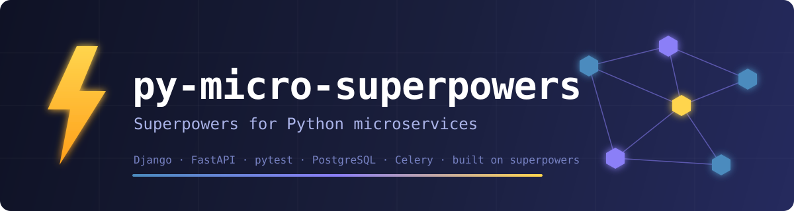
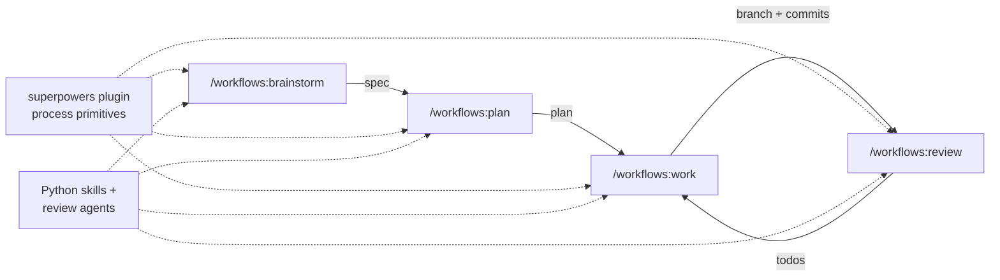

<p align="center">
  
</p>

<h1 align="center">py-micro-superpowers</h1>

<p align="center"><strong>Superpowers for Python microservices.</strong></p>

<p align="center">
  <a href="CHANGELOG.md"></a>
  
  
  
  <a href="LICENSE"></a>
</p>

A Claude Code plugin that gives Claude deep knowledge of the Python ecosystem — Django, FastAPI, pytest, Pydantic, Celery, PostgreSQL, PostGIS — and first-class support for multi-service monorepos. Built on Anthropic's [`superpowers`](https://github.com/obra/superpowers) plugin: superpowers owns the engineering process (brainstorm → plan → execute → review), this plugin supplies the Python domain expertise and microservice orchestration.

> Formerly `compound-engineering-feat-python`. Originally forked from [Compound Engineering Plugin](https://github.com/EveryInc/compound-engineering-plugin) by [Kieran Klaassen](https://github.com/kieranklaassen), fully rewritten for the Python ecosystem.

## What It Does

```
/workflows:brainstorm → /workflows:plan → /workflows:work → /workflows:review
```

Each step loads relevant skills (Django patterns, pytest conventions, PostgreSQL optimization…), spawns specialized review agents, and enforces quality gates — tests must pass, linting must be clean, pre-commit hooks must succeed — before anything ships.



For monorepos, every command detects your services (`*/pyproject.toml`), scopes work to the ones you pick, executes plans in dependency order, and propagates a `<focus_context>` block to every sub-agent so nested delegation never loses track of which service it is working on.

## Installation

Requires the `superpowers` plugin **v7.0.0 or later** (process primitives). The session-start check warns if it is missing or older:

```
/plugin marketplace add anthropics/claude-plugins-official
/plugin install superpowers@claude-plugins-official
```

Then add this repo as a marketplace and install:

```
/plugin marketplace add weorbitant/compound-engineering-feat-python-plugin
/plugin install py-micro-superpowers@py-micro-superpowers
```

To install from a local clone, use `/plugin marketplace add /path/to/checkout` instead.

### Optional Dependencies

Checked automatically on session start — you'll see warnings for anything missing:

| Tool | Used By | Install |
|------|---------|---------|
| `agent-browser` | `/test-browser`, `/feature-video`, design agents, bug reproduction | `npm install -g agent-browser && agent-browser install` |
| `rclone` | `/feature-video` (cloud uploads) | [rclone.org/install](https://rclone.org/install/) |

## Quick Start

```bash
# Brainstorm a feature idea
/workflows:brainstorm add rate limiting to the payment API

# Plan the implementation
/workflows:plan add rate limiting with Redis sliding window

# Execute the plan
/workflows:work docs/superpowers/plans/2026-04-01-rate-limiting.md

# Review the changes
/workflows:review
```

Brainstorm specs land at `docs/superpowers/specs/`; plans at `docs/superpowers/plans/`.

## Core Workflow Commands

Commands use the `workflows:` prefix to avoid collisions with Claude Code built-ins (`/plan`, `/review`).

| Command | Purpose |
|---------|---------|
| `/workflows:brainstorm` | Explore requirements before planning (delegates to `superpowers:brainstorming`) |
| `/workflows:plan` | Generate implementation plans (delegates to `superpowers:writing-plans`) |
| `/workflows:work` | Execute a plan with Python quality gates (`--method subagent` → `superpowers:subagent-driven-development`, `--method native` → `superpowers:executing-plans`) |
| `/workflows:review` | Multi-agent Python code review (delegates to `superpowers:requesting-code-review`) |

Each workflow command:
- Loads project-specific skills from the `py-micro-superpowers.local.md` configuration
- Auto-detects multi-service monorepos and adjusts behavior accordingly
- Propagates service context to all sub-agents to prevent focus loss

## Utility Commands

| Command | Description |
|---------|-------------|
| `/deepen-plan` | Enrich a plan with parallel research agents for each section |
| `/changelog` | Generate changelogs from recent merges |
| `/create-agent-skill` | Guided skill creation |
| `/generate_command` | Generate new slash commands |
| `/reproduce-bug` | Reproduce bugs using logs and browser automation |
| `/resolve_parallel` | Resolve TODO/FIXME comments in parallel |
| `/resolve_todo_parallel` | Resolve todos from plan files in parallel |
| `/triage` | Triage and prioritize issues |
| `/test-browser` | Browser tests on PR-affected pages |
| `/agent-native-audit` | Architecture review against 8 agent-native principles |
| `/feature-video` | Record video walkthroughs and attach to PR |
| `/report-bug` | Report a plugin bug |
| `/heal-skill` | Fix skill documentation issues |

## Agents (25)

Agents run as sub-processes during workflows, grouped by specialization. A 3-tier model strategy keeps cost proportional to stakes:

- **Opus** — high-stakes judgment: architecture, security, migrations, data integrity, performance
- **Sonnet** — domain review and research: framework reviewers, researchers, design agents
- **Haiku** — mechanical tasks: linting and type-checking

Reviewers work from baked-in checklists with PASS/FAIL code examples, backed by the plugin's skills for deep reference. When a finding hinges on version-specific library behavior they aren't certain of, they verify it against live docs through the bundled context7 MCP server rather than asserting from memory.

### Review

| Agent | Model | Focus |
|-------|-------|-------|
| `python-quality-reviewer` | sonnet | PEP 8 style, modern syntax, type annotations, Pydantic v2 |
| `django-reviewer` | sonnet | Models, views, URLs, admin, signals, middleware, Ninja |
| `django-drf-reviewer` | sonnet | DRF serializers, viewsets, permissions, pagination |
| `django-celery-reviewer` | sonnet | Task design, idempotency, retry strategy, queue routing |
| `fastapi-reviewer` | sonnet | Routes, DI, async correctness, OpenAPI + SQLAlchemy data layer, Alembic |
| `pytest-reviewer` | sonnet | Fixtures, isolation, assertions, mocking, async |
| `postgresql-reviewer` | sonnet | Query optimization, indexing, connection pooling |
| `postgis-reviewer` | sonnet | SRID consistency, spatial indexing, GeoDjango |
| `migration-reviewer` | opus | Migration safety, data-migration validation, schema drift (Django + Alembic) |
| `architecture-strategist` | opus | Architectural integrity, patterns, anti-patterns, duplication |
| `data-integrity-guardian` | opus | Data models, constraints, transactions, privacy |
| `deployment-verification-agent` | opus | Go/No-Go deployment checklists |
| `performance-oracle` | opus | Algorithmic complexity, queries, async runtime, memory |
| `security-sentinel` | opus | Security audits and OWASP compliance |
| `agent-native-reviewer` | sonnet | Action + context parity for agent-native features |
| `code-simplicity-reviewer` | sonnet | Final pass for simplicity and minimalism |

### Research

| Agent | Model | Focus |
|-------|-------|-------|
| `best-practices-researcher` | sonnet | Official docs, version constraints, community best practices |
| `git-history-analyzer` | sonnet | Git history and code evolution |
| `repo-research-analyst` | sonnet | Repository structure and conventions |

### Design

| Agent | Model | Focus |
|-------|-------|-------|
| `design-implementation-reviewer` | sonnet | UI vs Figma comparison, with iterative fix mode |
| `design-iterator` | sonnet | Iterative UI refinement |

### Workflow

| Agent | Model | Focus |
|-------|-------|-------|
| `bug-reproduction-validator` | sonnet | Systematic bug reproduction |
| `python-lint` | haiku | ruff + mypy linting and type-checking |
| `pr-comment-resolver` | sonnet | PR comment resolution |
| `spec-flow-analyzer` | opus | User flow gap analysis |

## Skills (21)

Skills provide domain knowledge that agents and workflows load on demand — reference documentation, conventions, and patterns. Process primitives (brainstorming, planning, TDD, git worktrees, parallel agents) come from the `superpowers` plugin.

### Python Core
- **`python-style`** — PEP 8, naming, imports, logging with emoji prefixes
- **`python-typing`** — Type hints, Pydantic v2, Protocol, generics

### Django
- **`django-patterns`** — Models, views, admin, signals, middleware, Django Ninja
- **`django-drf`** — DRF serializers, viewsets, permissions, authentication
- **`django-async`** — Celery task patterns, Django Channels

### FastAPI
- **`fastapi-patterns`** — Routes, dependency injection, async patterns, auth
- **`fastapi-sqlalchemy`** — SQLAlchemy 2.0 async, Alembic migrations

### Testing
- **`pytest-patterns`** — Fixtures, parametrize, mocking, async testing

### Database
- **`postgresql-patterns`** — Schema design, indexing, query optimization, monitoring
- **`postgis-patterns`** — Spatial queries, GeoDjango, GeoAlchemy2

### Architecture & Design
- **`agent-native-architecture`** — Agent-native app patterns (action parity, context injection, shared workspace)
- **`frontend-design`** — Production-grade frontend interfaces

### Microservice Support
- **`microservice-focus`** — Service discovery, `--services` parsing, multi-service prompting, `<focus_context>` construction

### Development Tools
- **`setup`** — Interactive project configuration for review agents and workflow skills

### Content & Workflow
- **`commit`** — Conventional commits with gitmoji, logical grouping, pre-commit handling
- **`document-review`** — Structured document improvement
- **`file-todos`** — File-based todo tracking
- **`resolve-pr-parallel`** — Parallel PR comment resolution

### Integrations
- **`rclone`** — Cloud storage uploads (S3, R2, B2)
- **`agent-browser`** — CLI browser automation via Vercel's agent-browser
- **`gemini-imagegen`** — Image generation/editing with Google Gemini API

## MCP Servers

| Server | Description | Tools |
|--------|-------------|-------|
| `context7` | Framework documentation lookup | `resolve-library-id`, `query-docs` |

Supports 100+ frameworks including Django, FastAPI, SQLAlchemy, Celery, and more. Starts automatically when the plugin is enabled. If it doesn't, add it manually to `.claude/settings.json`:

```json
{
  "mcpServers": {
    "context7": { "type": "http", "url": "https://mcp.context7.com/mcp" }
  }
}
```

## Configuration

### Workflow Skills

Customize which skills load per workflow via `py-micro-superpowers.local.md` in your project root (a legacy `compound-engineering.local.md` is still honored):

```yaml
---
workflow_skills:
  brainstorm: [django-patterns, my-company-domain]
  plan: [django-patterns]
  work: [django-patterns, pytest-patterns]
  review: [django-patterns, pytest-patterns]
---
```

Skills are **additive** — loaded alongside each command's built-in skills. Project-local skills in `.claude/skills/` can also be referenced by name.

### Review Agents

Run `/setup` — it auto-detects your stack (Django, FastAPI, DRF, Celery, SQLAlchemy, PostgreSQL, PostGIS, Pydantic) and writes the `review_agents` roster used by `/workflows:review` into `py-micro-superpowers.local.md`.

## Microservice Support

Focus Gate logic lives in the `microservice-focus` skill, invoked once by each workflow command:

- **Auto-detection** — discovers services via `*/pyproject.toml` at root level
- **Focus Gate** — each workflow command prompts for relevant services (or accepts `--services`)
- **Dependency-aware execution** — plans with `services:` YAML frontmatter execute in topological order (wavefront pattern)
- **Per-service context** — loads each service's README, dependencies, and structure before acting
- **Stack-aware routing** — Django patterns for Django services, FastAPI for FastAPI, per-service agent rosters

### Pipeline Mode

All workflow commands accept `--services` for automated invocation (skips all interactive prompts):

```bash
/workflows:brainstorm --services order-service,payment-service "add cross-service event bus"
```

### Documentation Output

| Doc Type | Single Service | Multi-Service |
|----------|---------------|---------------|
| Specs | `docs/superpowers/specs/` | `{service}/docs/superpowers/specs/` per service |
| Plans | `docs/superpowers/plans/` | Root overview + per-service plan files under `{service}/docs/superpowers/plans/` |

## How It Works

`/workflows:work` is the engine that turns plans into shipped code:

1. **Load context** — project workflow skills + microservice focus gate (execution order for multi-service plans)
2. **Delegate execution** — Subagent-driven (`superpowers:subagent-driven-development`: fresh implementer + reviewer per task) or Native (`superpowers:executing-plans`: this session implements, one whole-branch review). Pick with `--method`, or reuse the choice made at the end of `/workflows:plan`
3. **Python quality gate (mandatory)** — full pytest suite + ruff + mypy + pre-commit hooks must all pass; loops until clean
4. **Ship** — commit via the `commit` skill, push, open a PR that includes a Post-Deploy Monitoring & Validation plan

Never ships with failing tests, never skips hooks.

## Development

`scripts/validate.sh` runs the structural checks CI enforces on every push: frontmatter integrity, reference-link resolution, script compilation, stale-reference guards, and component-count consistency.

## Version History

See [CHANGELOG.md](CHANGELOG.md) for detailed version history.

**Current version: 4.1.0** — synced with superpowers v7.0.0.

## Contributing

Contributions are welcome. The plugin is open source under the MIT license.

1. Fork the repo and create a feature branch
2. Follow the conventions encoded in the plugin's own skills (PEP 8, type hints, pytest, conventional commits)
3. Run `./scripts/validate.sh` and the plugin against itself (`/workflows:review`) before opening a PR
4. Open a PR against `main` — include a short rationale and any relevant plan/spec docs

Issues, ideas, and discussion: [GitHub Issues](https://github.com/weorbitant/compound-engineering-feat-python-plugin/issues).

## License

MIT — See [LICENSE](LICENSE)

Original work copyright (c) 2025 [Kieran Klaassen](https://github.com/kieranklaassen). Modifications copyright (c) 2026 [BaronVonSario](https://github.com/BaronVonSario).
